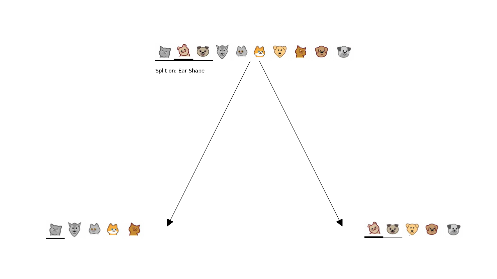
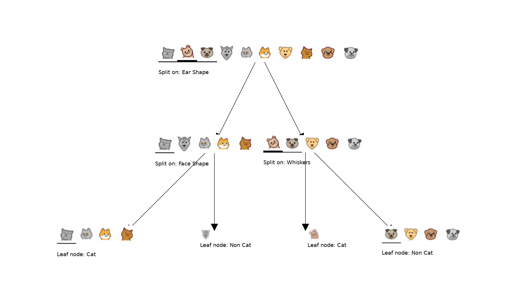

# Decision Trees: Classification from Scratch

This project is a small, visual introduction to how a binary classification
decision tree chooses questions that separate labeled examples. It uses ten
illustrated animal examples and three binary features, then builds shallow
trees by maximizing information gain.

The implementation is intentionally explicit: the entropy calculation, data
splits, weighted child entropy, information gain, feature selection, and
recursive construction are all visible in Python. It is a learning
demonstration, not a general-purpose estimator.

## What you will learn

- How class proportions determine entropy and uncertainty.
- How a binary feature partitions a node into two groups.
- How to calculate weighted child entropy and information gain.
- How a greedy decision tree chooses a feature at each node.
- How tree depth changes the classification rules and the resulting diagram.

## Project files

```text
Decision Tree/
├── classification_tree.py
├── utils.py
└── images/
    ├── 0.png ... 9.png
    ├── plots/
    │   └── Probability vs Entropy.png
    └── decision_tree/
        ├── Root_Node_Split.png
        └── Classification_DT_Depth_2.png
```

- **`classification_tree.py`** is the runnable lesson. It defines the example
  data, demonstrates entropy and candidate split calculations, then builds and
  displays trees with maximum depths 1 and 2.
- **`utils.py`** contains the reusable calculations and plotting routines. It
  also loads the numbered animal pictures and arranges them into node images.
- **`images/0.png` through `images/9.png`** are the ten examples, identified by
  their row index in the dataset.
- **`images/plots/`** and **`images/decision_tree/`** contain saved illustrations
  of the concepts and tree structures. The script itself opens plots in
  interactive Matplotlib windows; it does not save or overwrite these images.

Python's `__pycache__` directory, if present, contains generated bytecode and
is not part of the source code or required to run the project.

## Setup and run

Run the following from this project directory:

```powershell
python -m pip install numpy pandas matplotlib pillow networkx pydot
python classification_tree.py
```

The script imports `pandas`, though the example currently uses NumPy arrays and
does not otherwise use pandas. Graphviz is optional: when its `dot` executable
is available, it is used to lay out the tree; otherwise `utils.py` falls back
to a NetworkX layout. `pydot` is still needed by the Graphviz layout integration.

The program prints intermediate values and opens a probability-versus-entropy
plot, followed by tree visualizations. Close each plot window to let execution
continue to the next one. A graphical display is required for these plots.

## The example data

`classification_tree.py` defines `X_train` as a 10-by-3 NumPy array and
`y_train` as the corresponding binary labels:

- `y = 1`: Cat
- `y = 0`: Non Cat
- Feature columns: Ear Shape, Face Shape, Whiskers
- Feature value `1` goes to the left child; value `0` goes to the right child.

The images in each row below are loaded from `images/<index>.png`.

| Index | Example | Ear Shape | Face Shape | Whiskers | Label |
|---:|:---:|---:|---:|---:|:---|
| 0 |  | 1 | 1 | 1 | Cat |
| 1 |  | 0 | 0 | 1 | Cat |
| 2 |  | 0 | 1 | 0 | Non Cat |
| 3 |  | 1 | 0 | 1 | Non Cat |
| 4 |  | 1 | 1 | 1 | Cat |
| 5 |  | 1 | 1 | 0 | Cat |
| 6 |  | 0 | 0 | 0 | Non Cat |
| 7 |  | 1 | 1 | 0 | Cat |
| 8 |  | 0 | 1 | 0 | Non Cat |
| 9 |  | 0 | 1 | 0 | Non Cat |

Each row is a training example; its index connects the feature values and label
to the corresponding picture. The helper visualizations use these pictures to
show which examples reach each node.

## How the algorithm works

### 1. Entropy measures class uncertainty

For a node with positive-class fraction \(p\), binary entropy is

$$
H(p) = -p \log_2(p) - (1-p)\log_2(1-p).
$$

The implementation defines entropy as zero when `p` is 0 or 1, since a pure
node has no class uncertainty. Entropy is highest at `p = 0.5` (one bit), where
the classes are evenly mixed.


In `classification_tree.py`, `entropy(p)` accepts the positive-class
probability directly. In `utils.py`, `compute_entropy(y)` receives labels,
calculates their positive-class fraction, and then applies the same formula.

### 2. A feature makes a binary split

`split_indices` in the main script and `split_dataset` in `utils.py` both
partition example indices by one feature:

- Left child: feature value is `1`.
- Right child: feature value is `0`.

The indices are retained rather than copying or modifying the original dataset.
This lets each recursive step work with a subset of the original examples.

### 3. Information gain scores a candidate question

For a candidate split, the child entropies are weighted by the fraction of
examples that reach each child:

$$
H_{\mathrm{children}} =
\frac{n_L}{n} H_L + \frac{n_R}{n} H_R,
\qquad
\mathrm{Gain} = H_{\mathrm{parent}} - H_{\mathrm{children}}.
$$

`weighted_entropy` and `information_gain` in `classification_tree.py`
demonstrate these quantities for the root. `compute_information_gain` in
`utils.py` performs the same calculation for a subset of examples at any tree
node.

For this dataset, the root entropy is `1.000` bit. The candidate root splits
have these information gains:

| Feature | Information gain |
|:---|---:|
| Ear Shape | 0.278 |
| Face Shape | 0.035 |
| Whiskers | 0.125 |

Ear Shape is therefore the best first split: it produces the largest reduction
in class uncertainty. The corresponding weighted child entropy is `0.722` bit.
These values are specific to the ten examples in this demonstration.

### 4. The tree is built recursively

`get_best_split` in `utils.py` evaluates each feature with
`compute_information_gain` and selects the feature with the greatest positive
gain. `build_tree_recursive` then:

1. Stops when the configured maximum depth is reached.
2. Finds the best feature for the current examples.
3. Splits the current indices into left (`1`) and right (`0`) groups.
4. Adds the split to the `tree` list.
5. Recursively processes the left and right groups.

The tree list stores tuples of `(left_indices, right_indices, feature)`. The
depth limit controls the number of split levels; the depth-2 call uses the
root split and then makes one additional split in each child.

`generate_tree_viz` draws these splits and shows the example pictures at each
node. With depth 2, the learned rules for this particular data are:

```text
Ear Shape = 1
├── Face Shape = 1  -> Cat
└── Face Shape = 0  -> Non Cat

Ear Shape = 0
├── Whiskers = 1     -> Cat
└── Whiskers = 0     -> Non Cat
```

Each leaf shown here is pure for the provided training examples. The
visualization labels are inferred from those examples; the implementation
does not expose a separate `predict` method.

### Root split

The following figure illustrates the best root split: examples with Ear Shape
`1` go left, and examples with Ear Shape `0` go right.



### Depth-2 classification tree

The second level further separates the groups using Face Shape on the left
branch and Whiskers on the right branch.



## Code guide

### `classification_tree.py`

This script is organized as a walkthrough:

1. Imports the libraries and calls `ut.plot_entropy()`.
2. Creates the fixed training arrays and prints their shapes and an example.
3. Defines and demonstrates the scalar `entropy` calculation.
4. Defines `split_indices`, `weighted_entropy`, and `information_gain` to
   illustrate root-level calculations.
5. Prints the root information gain for each named feature.
6. Calls `ut.build_tree_recursive` and `ut.generate_tree_viz` twice, with
   `max_depth=1` and `max_depth=2`.

The helper definitions in this script are for explaining the calculations;
the recursive construction and diagrams are implemented in `utils.py`.

### `utils.py`

- `tree_layout(graph)` attempts a Graphviz layout and falls back to a
  NetworkX multipartite layout if the Graphviz executable is unavailable.
- `compute_entropy(y)` calculates binary entropy from a label array and
  returns zero for an empty array or a pure class.
- `split_dataset(X, node_indices, feature)` partitions a node's indices by a
  binary feature.
- `compute_information_gain(X, y, node_indices, feature)` calculates the
  reduction in entropy for that feature at the selected node.
- `get_best_split(X, y, node_indices)` searches all feature columns and
  returns the one with the largest positive information gain.
- `build_tree_recursive(...)` builds the requested number of split levels
  and prints each split and depth-limit leaf.
- `generate_node_image(node_indices)` opens the indexed images and combines
  them into a single picture representing a node.
- `generate_split_viz(...)` displays a single split. It is available as a
  helper but is not called by the main script.
- `generate_tree_viz(root_indices, y, tree)` draws the full tree represented
  by the split list.
- `plot_entropy()` plots the binary entropy curve and marks its values at
  `p = 0`, `0.5`, and `1`.

## Scope and limitations

- This is a small fixed dataset, not a train/test experiment or a general
  estimator API.
- The implementation uses binary labels and binary feature values, with
  hard-coded names for the three example features.
- Tree growth is controlled by maximum depth. It does not implement pruning,
  minimum-sample constraints, missing-value handling, or a prediction API.
- `get_best_split` expects a positive-gain split to exist. It returns `-1` if
  no feature has positive gain; the current example does not hit that case.
- The illustrations and reported gains explain behavior on these training
  examples only; they do not measure generalization to unseen data.
